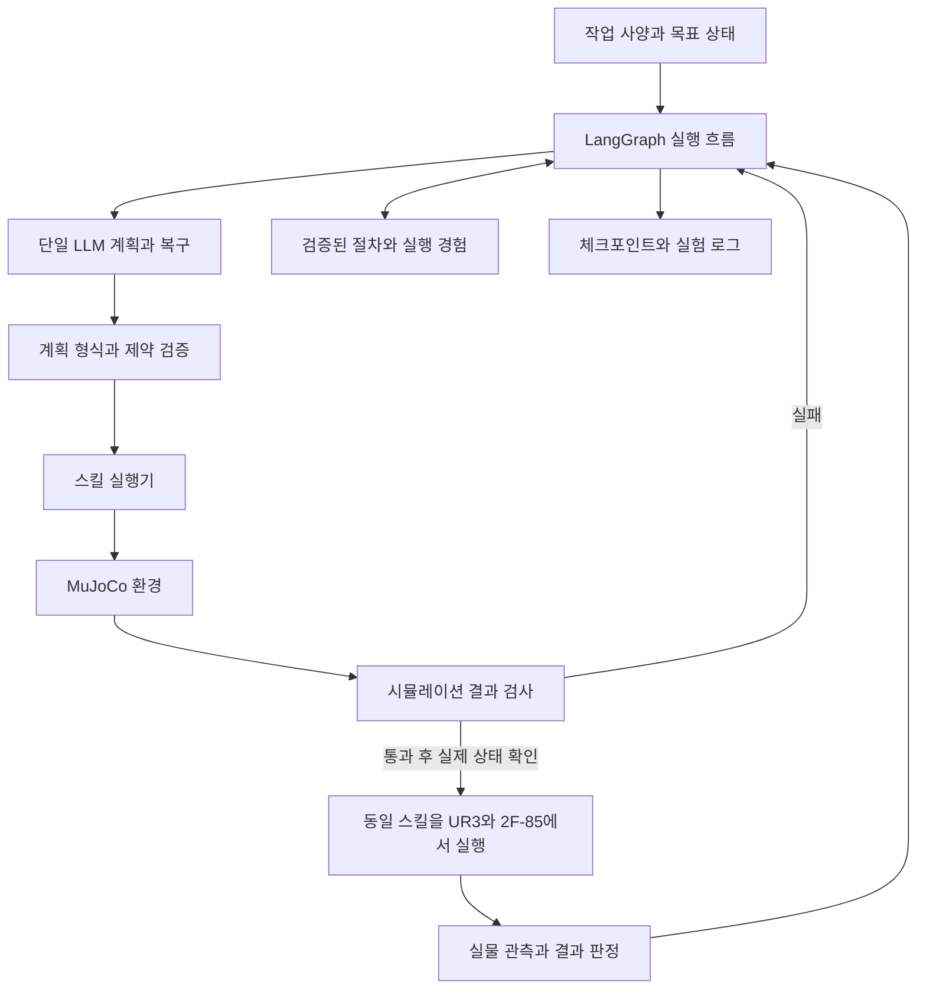

# UR 계열 조립 에이전트 시스템 — 4주·10부품 목표

작성일: 2026-10-26. 이 문서는 개발 계획이며, 현재 구현 진척은 README와 단계별 설명서를 참고한다. 아래 성능 수치는 달성 결과가 아니라 개발 단계의 제안 기준이다.

프로젝트 저장소는 `ramen0519/llm-robot-assembly`, 개발 경로는 `C:\dev\llm-robot-assembly`다. 첫 구현은 MuJoCo 조립 시뮬레이션이며, 실제 장비·부품 상태의 반영과 실행 결과 피드백을 연결한 뒤 디지털트윈 기반 시스템으로 확장한다. Sim-to-Real은 검증한 스킬·절차를 실물에 적용하는 측면을 뜻하며, 초기 과제에 신경망 제어 정책 학습을 포함하지 않는다.

처음 읽을 때는 [입문 설명서](BEGINNER_GUIDE.md)를 먼저 참고한다. 사용자가 로봇 분야를 처음 배우는 상태이므로 아래 4주 목표는 기존 제어·기구학·모션 계획 기능을 재사용하는 조건부 계획이다.

**확정 조건은 1인 개발, 약 4주, 실물 조립 시연 필수, 최종 조립체 약 10부품 목표다.** 사용자는 많은 시간을 투입할 수 있고 부품·지그의 직접 설계와 3D프린팅이 가능하다. LLM API, LangGraph 싱글에이전트, 스킬·메모리 축적 방향은 유지한다. UR3·Robotiq 2F-85·RGB-D 카메라를 사용할 수 있다. 파인튜닝과 멀티에이전트 구현·비교는 이번 4주 범위에서 제외하고 확장 지점만 유지한다.

**개발 순서는 MuJoCo 시뮬레이션을 먼저 완성하고, 그다음 실물 로봇을 연결하는 것으로 정한다.** 사용자는 새로 구축하는 상황이며 재사용 가능한 코드가 확보됐다고 가정하지 않는다. 연구실 선배들의 발표자료는 사용자가 직접 구현한 결과가 아니다. 해당 자료에는 UR3e·Robotiq 2F-85, MoveIt·URSim·RViz와 후반의 RoboDK 구성이 명시되어 있다. 소스 확보 시 재사용 가능성을 검토한다. 실제 로봇 제어기·소프트웨어 버전, 그리퍼 통신 연결, 카메라 모델, 정확한 투입 시간과 제출일은 아직 확인되지 않았다. UR3와 UR3e를 같은 모델로 취급하지 않는다.

장비 표기 주의: 아래 UR3 표기는 초기 대화에서 사용한 명칭이다. 사용자의 후속 지시에 따라 시뮬레이션에는 UR3e 모델을 선택해 정지 표시와 제한된 한 관절 이동·도착 판정, 2F-85 장착 상태의 초기 자세 유지와 물체 없는 개폐, 명목 TCP의 위치·방향까지 확인했다. 실제 사용할 장비는 별도로 확인하며 UR3와 UR3e를 같은 모델로 취급하지 않는다. 모델 출처는 [3단계 설명서](STEP_03_UR3E_MODEL.md), 한 관절 제어는 [4단계 설명서](STEP_04_ONE_JOINT.md), 그리퍼 결합은 [5단계 설명서](STEP_05_GRIPPER_MOUNT.md), 개폐 제어·실제 간격 판정은 [6단계 설명서](STEP_06_GRIPPER_CONTROL.md), TCP 정의·좌표축 확인은 [7단계 설명서](STEP_07_TCP_FRAME.md)를 참고한다.

아래 주차는 개발 시작부터의 순서를 뜻한다. Codex를 활용해 구현과 디버깅을 진행하고 기존 기구학·모션 계획 기능을 재사용한다. 첫 7–10일을 시뮬레이션 v1 완성의 목표 기간으로 제안하고, 통과 후 실물 연결·조립 검증으로 이동한다. 이는 확정 소요 시간이 아니다. 시뮬레이션에 기간을 모두 사용하지 않도록 7일차와 10일차에 진척을 점검한다. 집중 개발이 가능해도 출력·재출력, 장비 예약, 접촉 제어 검증 시간은 필요하며 10부품 실물 완성을 보장하는 일정은 아니다.

**필수 결과물은 제한된 조립 작업을 시뮬레이션에서 검사한 뒤 실제 UR3로 실행하고 경험을 재사용하는 시스템이다.**

- 로봇: UR3 한 대, 2F-85 그리퍼, 고정된 베이스와 부품 트레이.
- 첫 동작: 부품 하나를 집어 목표 위치에 놓기. 그다음 여유 간격이 있는 수직 삽입.
- 최종 조립: 선행조건과 조립 중간 상태가 있는 약 10개 부품의 기구 조립체. 아래 수직 조립 기어박스 모형을 후보로 검토하되, 제품 형상은 아직 확정하지 않았다.
- 초기 동작 검증: 단일 결합부터 시작하고, 선행조건을 지키는 3부품·6부품 부분 조립을 거쳐 10부품으로 확장한다. 부분 조립은 개발 통과 기준이며 최종 목표를 대체하지 않는다.
- 입력: 부품 ID, 형상·치수, 결합 관계, 목표 상태, 허용 스킬. 정답 동작 순서는 제공하지 않는다.
- 변화: 트레이 위치 변경, 일부 부품이 이미 조립된 상태, 한 단계의 실패, 호환되는 조립체 구성 변경. 새로운 구성의 기하·물리적 적합성도 검증한다.
- 실패 예시: 시뮬레이션에서의 잘못된 정렬·도달 불가, 실물에서 탐지 가능한 집기 실패. 접촉 실패를 반복 유발하는 실물 실험은 첫 시연의 필수 항목이 아니다.
- 초기 인식: 시뮬레이션은 정답 상태, 실물은 보정한 고정 치구와 정해진 부품 배치. 이 조건을 명시하고 자유 배치 물체 인식 성능으로 보고하지 않는다.
- 카메라: 결과 확인과 기록을 우선한다. 신뢰할 만한 마커/깊이 측정이 빨리 확보되면 위치 확인에 사용한다. 자유 물체 인식 모델 개발은 후속 과제다.
- 최종 시연: 작업 입력 → 경험 검색과 계획 → 시뮬레이션 검증 → 현재 실물 상태 확인 → 실물 조립 → 결과 판정·경험 저장 → 관련 작업에서 재사용.
- 사람이 부품을 준비하고 trial 사이에 초기화할 수 있다. 이 준비와 실행 중 개입을 구분해 기록한다. 실행 중 사람이 부품을 맞춰줘야 성공했다면 자율 성공으로 집계하지 않는다.

이번 4주의 주장은 ‘알려진 종류의 조립 작업에서 변경된 조건을 처리하고 검증된 경험을 재사용한다’로 한정한다. 새로운 부품 조합·치수 변형 일반화는 실제로 확보한 시험 범위만 보고한다. 임의의 물체 사진에서 형상과 결합법을 모두 추론하거나 모델 사전학습에 없던 물체를 이해한다는 주장은 하지 않는다.

**10개 부품을 공통된 4–5종의 조작 스킬로 조립하도록 기구를 설계한다.** 부품 개수, 결합 유형 수, 조립 순서의 제약, 파지·접촉 난도를 별개로 관리한다. 순서가 잘못되면 접근이 막히고, 현재 조립 상태에 따라 다음 작업이 달라지는 구성을 선택한다.

설계 후보는 위쪽에서 조립하는 3축 기어박스 모형이다. 아래 구성은 설계 제안이며 CAD, 파지 가능성, 공차, 실물 동작은 아직 검증되지 않았다.

| 제품 부품 | 수량 | 필요한 작업 |
|---|---:|---|
| 하부 하우징 | 1 | 시작 전에 외부 지그에 고정 |
| 축 | 3 | 하우징의 지지 위치에 삽입 |
| 기어 | 3 | 해당 축에 끼우고 인접 기어와 맞물림 확인 |
| 스페이서 | 2 | 지정 축의 높이·간격 형성 |
| 상부 덮개 | 1 | 내부 조립 완료 후 정렬·배치 |
| 합계 | 10 | 하우징을 미리 고정하면 로봇이 조립하는 부품은 9개 |

외부 지그와 트레이는 제품 부품 수에 포함하지 않는다. 10개와 10종의 부품은 다르며 반복 부품도 BOM에 명시한다. 하우징의 지지 높이와 스페이서를 함께 설계해 기어의 맞물림 높이를 맞춘다. 기어 치형의 위상 정렬과 덮개의 여러 축 동시 정렬이 주요 기술 위험이므로, 시뮬레이션에서는 이 결합부터 검사하고 실물 단계에 들어가면 해당 시험편부터 출력·확인한다. 시뮬레이션에서 선택한 공차는 실물 검증 전까지 잠정값이다.

기어박스를 선택한다면 조립 완료와 수동 회전 기능 검사를 구분해 기록한다. 기어 접촉 동작을 일정 내 검증하기 어렵다면 10부품 목표를 유지하면서 내부 부품을 방향 제약이 있는 기구 모듈로 바꾸는 대안을 사용자와 결정한다. 기능 검증 없이 기능성 기어박스를 완성했다고 표현하지 않는다.

각 부품에 파지 구간, 그리퍼 접근 공간, 삽입 유도면, 안정적인 중간 지지 상태, 관측 가능한 완료 표시를 확보한다. 덮개는 위치 결정과 여유 구간을 나누어 동시 정렬 부담을 줄인다. 정확한 간격은 프린터·재료·실측 오차에 맞춘 시험편으로 결정한다.

조립 순서에는 경로·중간 안정성·가용 로봇의 실행 가능성이 함께 작용한다. 물리 검증을 포함한 계획의 참고 자료로 [ASAP](https://asap.csail.mit.edu/)를 사용할 수 있다. 이 연구가 본 10부품 후보의 실현 가능성을 검증한 것은 아니다.

필수 구현은 공통 데이터 계약, 기본 스킬 3–5개, 최소 MuJoCo 환경, 실물 adapter, 단일 계획·복구 루프, 단순 경험 저장/검색, 실행 로그다. 벡터 DB, 자동 스킬 코드 생성, 복잡한 승격 서비스, 정밀 압입·나사 체결, 자동 물성 추정, 웹 대시보드, 실행 중단 지점에서의 완전 자동 재개는 후속으로 둔다. 아래 상세 계약과 확장 설계는 변경 경계를 정하기 위한 것으로 모든 기능을 4주 안에 구현하라는 의미가 아니다.

**에이전트 판단, 물리 실행, 검증, 저장을 별도 모듈로 나눈다.**



| 모듈 | 책임 | 핵심 경계 |
|---|---|---|
| Task loader | 작업 사양·부품·목표 읽기 | 실행할 Python 코드나 자유 형식 지시를 작업 파일에서 실행하지 않음 |
| LangGraph runner | 상태, 분기, 반복, 예산, 종료 | 그래프 노드 수와 에이전트 수는 다름 |
| Planner | 스킬 순서·허용 파라미터 선택, 실패 후 계획 수정 | 최초에는 하나의 에이전트 정책과 하나의 모델 설정 사용 |
| Plan validator | 스키마, ID, 전제조건, 파라미터, 작업영역 검사 | 도달 가능성·경로 검사는 모션 계층에 요청 |
| Skill registry / executor | 승인된 동작 호출, 실행 순서, action ID 관리 | 에이전트가 관절값을 매 순간 생성하지 않음 |
| Environment adapter | 관측, 동작 실행·상태 조회·취소 | 시뮬레이터와 실제 장비의 공통 의미 제공 |
| Motion backend | IK, 궤적, 로봇·그리퍼 제어 | 시뮬레이터용과 실물용 구현은 달라질 수 있음 |
| Verifier | 전제·후조건, 완료, 실패 판정 | LLM 자기평가를 성공의 근거로 사용하지 않음 |
| Experience store | 관련 경험 검색·갱신·버전 관리 | 실행 로그 전체를 매번 프롬프트로 보내지 않음 |
| Experiment logger | 비용, 호출, 시드, 실패, 결과 기록 | 실패한 호출과 재시도의 비용도 포함 |

처음에는 한 저장소와 로컬 Python 실행 프로그램으로 구현한다. 웹 서버, 분산 큐, 컨테이너 군집은 필요한 시점에 추가한다. CLI와 MuJoCo viewer, JSONL 로그만으로 첫 시연이 가능하도록 한다. LangGraph는 LLM 단계와 일반 코드 단계를 함께 구성할 수 있다. [공식 개요](https://docs.langchain.com/oss/python/langgraph/overview)

위 구조도는 실물 확장 후의 전체 구조다. 첫 버전은 `run_mode=sim_only`로 실행한다. 이 모드에서는 실물 상태 확인·실물 실행 노드로 진입하지 않고, 시뮬레이션 실행 → 결과 판정 → 실패 시 재계획 또는 종료 → 경험 저장으로 끝난다. 같은 시뮬레이션 실행을 검증과 실행이라는 이름으로 중복 수행할 필요는 없다. 이후 실물 연결 때 `run_mode=sim_then_real` 분기를 추가한다. 모드 이름은 프로젝트 설정 제안이며 LangGraph 내장 옵션이 아니다.

**LangGraph에는 하나의 판단 정책과 여러 일반 코드 노드를 둔다.**

기본 실행 순서는 다음과 같다.

1. `load_task`: 입력 검사, 설정·버전·실험 ID 고정.
2. `observe`: 현재 로봇·부품 상태 읽기.
3. `retrieve`: 로봇·부품·스킬·환경 버전 조건이 맞는 경험 최대 3개 검색.
4. `plan`: 단일 LLM이 구조화된 스킬 목록 생성. 복구 시에도 같은 정책을 사용한다.
5. `validate_plan`: 출력 형식, 스킬 존재, 인자 범위, 순서 제약 검사.
6. `simulate_plan`: 실제 작업 조건을 반영한 장면에서 스킬 계획을 실행하고 단계별 후조건과 전체 목표를 검사한다. 실패하면 예산 내에서 재계획한다.
7. `check_real_state`: 시뮬레이션에 사용한 조건과 실제 배치·버전의 일치 여부를 확인한다. 불명확하면 실물 동작을 시작하지 않는다.
8. `execute_next → verify_step`: 실물 스킬을 하나씩 실행하고 결과를 확인한다. 모든 동작이 끝나면 `verify_goal`로 실제 조립 상태를 판정한다.
9. 실물 실패는 원인이 확인되고 미리 검증된 복구 동작이 있을 때만 재관측·재계획·시뮬레이션 검증 후 제한적으로 재시도한다. 그 외에는 멈추고 실패/개입 필요로 기록한다.
10. 성공·복구 불가·예산 소진 중 하나로 종료한 뒤 `record_episode`에서 결과와 경험 저장.

계획 검증 실패는 물리 동작을 수행하지 않고 오류를 Planner에 반환한다. 이미 성공한 조립 단계는 현재 관측으로 확인한 뒤 유지한다. 실패 후 장면 전체 초기화를 복구로 간주하지 않는다. 초기화한 실험은 새 trial로 기록한다.

가져온 검증 절차가 작업과 정확히 호환되면 동일한 검증 단계를 거쳐 실행할 수 있다. 이 LLM 생략 기능은 별도 실험 옵션으로 두고, 초기 메모리 비교에서는 모든 LLM 실험군이 동일하게 최초 계획 호출을 하도록 한다.

기본 예산은 `max_plan_steps=60`, `max_replans=2`, `max_llm_requests=8`, `memory_top_k=3`으로 제안한다. 10부품의 여러 기본 동작과 제한된 복구를 수용하도록 단계 수를 늘리되, 물리 제어 주기마다 LLM을 호출하지 않는다. 구조화 출력 수정과 API 재시도도 전체 호출 수에 포함한다. 스킬별 제한 시간·에피소드 시간·토큰 상한·API 비용 상한은 설정 파일로 정하고 첫 유료 실행 전에 확인한다. 예산과 모델 가격표는 실험별로 고정하고 미확인 비용은 0으로 기록하지 않는다.

API 오류는 제한된 횟수로 재시도할 수 있지만, 물리 동작 노드에는 무조건적인 자동 재시도를 적용하지 않는다. 취소·시간 초과 후에는 장비 상태를 먼저 확인한다.

**다음 데이터 계약을 먼저 정하면 실물과 멀티에이전트로 확장할 때 변경 범위를 줄일 수 있다.**

| 계약 | 최소 필드 |
|---|---|
| `TaskSpec` | task_id, part_specs, goal_predicates, mating_relations, support_relations, constraints, allowed_skills |
| `WorldState` | observation_id, revision, timestamp, frame_id, robot_state, gripper_state, parts, assembled_parts, source, uncertainty, model_version |
| `SkillCall` | action_id, skill_id, skill_version, part_id, target_ref, parameters, expected_state_revision |
| `Plan` | plan_id, task_id, steps, assumptions, required_capabilities |
| `SkillResult` | action_id, status, error_code, state_before_ref, state_after_ref, measurements, duration |
| `VerificationReport` | satisfied_predicates, violated_predicates, unavailable_measurements, evidence_refs |
| `EpisodeRecord` | run_id, trial_id, task_id, seed, configuration_versions, action_refs, result, usage, timing, intervention_count |
| `ValidationReport` | plan_hash, scene_hash, robot_model_version, skill_versions, validation_profile, trial_results, applicability_limits |

초기 상태 스키마는 Pydantic 등으로 검증한다. 좌표 단위는 m, 각도는 rad, 회전은 `xyzw` 순서 quaternion으로 통일하고, 각 pose에는 기준 좌표계와 시각을 명시한다. 실제 SDK와 MuJoCo의 표현 차이는 adapter 내부에서 변환한다. 인자로는 가능한 한 부품·결합 위치 ID를 쓰고 현재 좌표는 실행 직전에 계산한다.

10부품 작업에서는 부품별 `not_started / in_progress / verified / failed / unknown` 상태와 관측 근거를 둔다. 현재 명령 번호만으로 조립 상태를 표현하지 않는다. 결합·지지 관계와 스킬 전제조건으로 선행 제약을 관리한다. 사람이 지정한 제약은 그 사실을 명시하고 CAD에서 자동 발견했다고 주장하지 않는다. 실패 시 확인된 부분 조립체를 보존하고 영향을 받는 후속 단계만 다시 계획한다.

`WorldState.source`는 예를 들어 `sim_ground_truth`, `fixture_nominal`, `sim_noisy_observation`, `rgbd_estimate`로 구분한다. 고정 치구의 공칭 위치와 실제 센서 관측을 구분한다. 관측 불확실성이 허용치를 넘으면 재관측하거나 종료한다. 없는 힘 측정값이나 가려진 물체 위치를 정상 측정값처럼 채우지 않는다.

관측 오차나 카메라 인식을 평가하는 단계에서는 Planner, 동작 목표 계산, 실행 중 결과 판정이 같은 관측 정보 경계를 사용한다. 숨겨진 물체 정답 좌표를 제어기에만 전달해 오차를 없애지 않는다. 시뮬레이터 정답 상태는 별도의 평가기에서 실제 성공 여부를 채점하는 데 사용할 수 있지만, 실행 중 에이전트로 역유입하지 않는다. 관측 기반 성공 판정과 정답 기반 성공 판정이 다른 경우도 기록한다.

공통 인터페이스는 다음 수준이면 충분하다. 아래는 구현 계약이며 이미 제공되는 라이브러리 API가 아니다.

```python
class EnvironmentAdapter:
    def capabilities(self) -> Capabilities: ...
    def observe(self) -> WorldState: ...
    def submit(self, command: SkillCall) -> ActionHandle: ...
    def action_status(self, action_id: str) -> SkillResult: ...
    def cancel(self, action_id: str) -> CancelResult: ...

class SimulationAdapter(EnvironmentAdapter):
    def reset(self, scene_spec, seed) -> WorldState: ...
    def snapshot(self) -> SnapshotRef: ...
    def restore(self, snapshot: SnapshotRef) -> WorldState: ...
```

`reset`, `snapshot`, `restore`는 시뮬레이션 전용이다. 실제 로봇에는 되감기 기능이 있다고 가정하지 않는다. 취소 응답 또한 즉시 물리적으로 정지했다는 뜻이 아니므로 정지 완료 상태를 확인한다.

실행 상태가 `unknown`이면 같은 명령을 재전송하지 않고 관측·로그와 대조한다. `action_id`별 접수·시작·종료 기록을 보관하되, 로컬 DB 기록만으로 로봇 동작의 exactly-once 실행이 보장된다고 주장하지 않는다. LangGraph 체크포인트에는 실행 중 동작 ID와 관측 참조를 저장한다. 그래프 재개는 시뮬레이터나 실물 상태 복원을 자동으로 의미하지 않는다.

시뮬레이션 snapshot은 물리 상태·제어기 상태·난수 상태와 모델/라이브러리 버전을 함께 관리한다. 복원이 검증되지 않았다면 동일 초기 조건으로 새 trial을 시작하고 이전 시도의 비용·실패를 남긴다. 실물 연결 시에는 재관측 후 진행 가능 여부를 확인한다.

4주 버전에서는 중단 후 완전 복원 기능을 구현하지 않고, 명시적 중단과 상태 확인 후 새 trial로 시작해도 된다. 공통 interface의 snapshot/restore는 선택 기능으로 둔다. 동작 ID와 실패 기록은 유지한다.

**스킬 축적은 기본 동작의 검증된 조합과 적용 조건을 축적하는 것부터 시작한다.**

| 기본 스킬 | 전제조건 예시 | 후조건 예시 |
|---|---|---|
| `pick` | 물체 존재, 그리퍼 비어 있음, 접근 가능 | 물체가 들리고 그리퍼와 상대 위치를 유지 |
| `place` | 해당 물체 파지 중, 배치 영역 확보 | 물체를 놓고 일정 시간 안정적으로 지지됨 |
| `align` | 해당 물체 파지 중, 목표 접근 가능 | 목표에 대한 상대 위치·방향 오차가 허용 범위 |
| `insert` | 정렬됨, 결합 조건 만족, 접근 거리 허용 | 목표 삽입 깊이·자세 조건 충족 |
| `retreat` | 현재 상태에서 후퇴 경로 확보 | 작업물과의 간섭을 벗어나 지정 지점 도달 |

각 스킬은 내부적으로 이동·그리퍼·관측을 조합한다. 물리 시뮬레이션 step이나 로봇 제어 주기마다 LLM을 호출하지 않는다. `insert`는 성공을 보장하는 함수가 아니라 실제 제어를 수행하고 결과를 보고하는 스킬이다.

실패 코드 초안: `INVALID_PLAN`, `PRECONDITION_FAILED`, `UNREACHABLE`, `COLLISION`, `GRASP_FAILED`, `MISALIGNED`, `INSERTION_INCOMPLETE`, `OBSERVATION_UNCERTAIN`, `TIMEOUT`, `EXECUTION_UNKNOWN`, `BUDGET_EXCEEDED`.

하나의 실패에 원인이 확정되지 않을 수 있다. 예를 들어 삽입 깊이 부족은 관측 사실이고, 마찰이 원인이라는 설명은 가설이다. 에이전트가 제안한 원인과 관측 사실을 구분해서 저장한다.

첫 단계에서는 허용된 스킬 조합과 제한된 파라미터 수정만 허용한다. 모델이 생성한 임의 Python 코드를 로봇에서 실행하는 기능은 만들지 않는다. 새로운 제어 동작은 직접 구현·검증해 registry에 추가한다.

**현재 작업 상태, 전체 실행 로그, 재사용할 경험을 구분해 저장한다.**

| 저장 종류 | 초기 구현 | 용도 |
|---|---|---|
| 작업 중 상태 | LangGraph checkpointer, 로컬 DB 기반 persistence | 단계·계획·동작 ID·예산 복구 |
| 원본 실행 기록 | JSONL와 파일 참조 | 재현, 실패 분석, 비용 계산 |
| 장기 경험 | SQLite와 명시적 검색 함수 | 호환되는 조립 절차·실패 사례 검색 |
| 스킬 정의 | 버전 관리하는 Python 코드와 JSON/YAML 메타데이터 | 실행 가능한 동작과 적용 범위 |

LangGraph의 checkpointer는 실행 thread의 상태를 보관하고 store는 여러 thread에서 사용할 데이터를 보관한다. 프로젝트의 SQLite 경험 저장소는 이 장기 저장 역할을 하는 자체 모듈로 시작할 수 있으며, LangGraph 내장 store 구현과 동일한 것으로 설명하지 않는다. [Persistence 문서](https://docs.langchain.com/oss/python/langgraph/persistence)

각 경험에는 `robot_model`, `gripper_model`, `part_family`, `dimension_range`, `skill_versions`, `scene_conditions`, `success_count`, `failure_count`, `evidence_refs`, `validation_level`을 저장한다. 고정된 월드 좌표의 궤적보다 물체·결합점 기준 절차와 허용 범위를 저장한다.

검색은 로봇·스킬 버전·부품군 등의 정확한 조건으로 먼저 거른 뒤 치수·목표 유사성으로 순위를 매긴다. 초기에는 벡터 DB 없이 구현한다. 경험 수와 검색 실패가 실제로 늘어났을 때 임베딩을 추가한다.

저장된 모든 성공 사례를 곧바로 검증된 스킬로 취급하지 않는다. 새 조합은 `candidate`로 기록하고, 지정한 검증 조건에서 예를 들어 10회 중 9회 이상 성공하면 해당 조건 범위의 `sim_validated`로 승격한다. 이 수치는 초기 제안이며 실물 안전성 증명이 아니다. 실물에서 별도 검증한 조건에는 `real_validated` 기록을 추가하고 실패 증가·버전 변경 시 재검증 또는 사용 중단 처리한다. 시뮬레이션 결과와 실물 결과는 각각의 검증 이력으로 유지한다.

4주 구현은 한 SQLite 저장소와 간단한 조건 검색으로 제한한다. 매 trial의 성공·실패와 적용 조건을 저장하고, 검증된 기본 스킬의 절차·허용 파라미터만 검색한다. 자동 승격 서비스는 필수가 아니다. 파라미터 재사용 시 치구·좌표 보정 버전이 같은지도 확인한다. 메모리의 효과가 없거나 비용이 늘어난 결과도 그대로 보고한다.

벡터 검색 없이도 ‘관련 절차 선택 → 새로운 위치에 맞게 파라미터화 → 실행 → 결과 반영’이라는 메모리 축적 효과를 보여줄 수 있다. 모든 기억을 붙이는 대신 관련 경험과 최근 실패의 수치 요약만 전달한다.

전체 절차 외에 ‘축과 스페이서 결합’, ‘모듈 정렬·삽입’처럼 재사용 가능한 부분 절차와 적용 조건도 저장한다. 이는 검증된 기본 스킬의 조합이다. 다른 배치에서 과거의 절대 좌표를 그대로 재생하지 않는다.

**MuJoCo에서 장면·모션·스킬을 먼저 구현하고 에이전트를 연결한다.**

MuJoCo는 Python 바인딩과 viewer를 제공한다. 초기 UR3e 모델은 공개 URDF에서 변환된 커뮤니티 MJCF의 고정 버전을 사용하며, 라이선스와 출처를 함께 보관한다. 현재는 모델 로딩, 제한된 한 관절 이동, 2F-85 결합·빈 상태 개폐와 명목 TCP의 위치·방향 및 모델 내부 변환을 확인했다. 검증 범위는 단계별 설명서에 기록하며, 범용 운동·파지·실물 TCP 보정·모델 정확도 검증은 이후 수행한다. 모델을 불러오는 것만으로 구동기와 그리퍼 연결까지 완성되는 것으로 가정하지 않는다. [MuJoCo Python](https://mujoco.readthedocs.io/en/stable/python.html), [공식 UR description](https://github.com/UniversalRobots/Universal_Robots_ROS2_Description)

MuJoCo Menagerie의 2F-85 모델을 고정 커밋·라이선스와 함께 통합하고, 현재 초기 자세에서 장착·개폐를 검증했다. 실제 설치된 그리퍼의 버전과 장착 변환·보정은 실물 단계에서 확인한다. 별도 공개 모델들이 존재해도 UR3+2F-85 통합 모델의 정확성이 자동 검증되는 것은 아니다. [Menagerie](https://github.com/google-deepmind/mujoco_menagerie)

부품은 직접 정의한 단순 형상으로 시작한다. 삽입 구멍은 여러 primitive/convex 형상을 조합해 실제 충돌 공간을 만들고 단면·접촉을 검사한다. 일반 mesh 충돌 형상의 convex 처리로 구멍이 막힐 수 있다. [MuJoCo modeling](https://mujoco.readthedocs.io/en/stable/modeling.html)

첫 시뮬레이션은 Python과 MuJoCo 중심으로 구성하고, 검증 가능한 기존 IK 구현을 연결한다. 라이브러리는 현재 개발 환경과 UR3 모델 호환성을 확인한 뒤 고정한다. 고정 작업대에서 상방 접근과 waypoint를 사용하는 제한된 경로부터 시작하고 관절 한계·경로 충돌·목표 도달 여부를 검사한다. 임의 장애물을 우회하는 범용 경로 탐색 기능은 필요해질 때 기존 플래너로 추가한다. 자체 수치 IK solver와 일반 경로 탐색기를 모두 새로 만드는 것을 필수 과제로 삼지 않는다.

ROS 2와 MoveIt 2 설치를 첫 MuJoCo 실행의 필수 조건으로 두지 않는다. 기존 연구실 환경에 바로 재사용 가능한 모션 기능이 있으면 활용하고, 이후 실물 연결 또는 복잡한 경로 계획이 필요할 때 MoveIt 2의 IK 플러그인·모션 계획·충돌 검사를 검토한다. [MoveIt 기구학](https://moveit.picknik.ai/main/doc/concepts/kinematics.html), [모션 계획](https://moveit.picknik.ai/main/doc/concepts/motion_planning.html)

첫 동작은 고정된 상방 접근과 검증된 waypoint로 제한할 수 있지만, 경로 중간의 충돌과 관절 한계를 검사해야 한다. 이 방식의 한계를 명시한다. 파지한 물체와 새로 조립된 부품도 계획 장면에 반영한다. 접촉 삽입은 자유 공간의 경로 계획만으로 해결되지 않으므로 별도의 스킬·결과 검증을 둔다.

MuJoCo와 실물로 보내는 관절 궤적의 공통 형식을 정의한다. 시뮬레이션 쪽은 MuJoCo 구동기·제어 루프에, 실물 쪽은 기존 UR 드라이버·컨트롤러에 연결한다. MoveIt과 MuJoCo의 연결은 별도 통합 작업이며 설치만으로 자동 완성된다고 가정하지 않는다. 좌표계·관절 순서·단위·TCP와 실제 장면 상태를 맞춘다.

초기 상태 설정 외에는 물체 좌표를 직접 바꿔 집기·삽입 성공을 만들지 않는다. 장면 구성용 mock, 비물리적 부착, 단순화된 그리퍼를 쓰는 디버그 모드는 명시적으로 구분하고 물리 성능 평가에서 제외한다.

전체 목표 판정은 부품의 상대 위치·자세, 삽입 깊이, 지지·안정 상태와 금지 충돌 여부를 확인한다. 스킬이 반환한 `success`만으로 전체 성공을 선언하지 않는다. 그리퍼를 놓는 작업은 놓은 뒤 안정 상태도 확인한다. 정확한 임계값은 CAD 간격과 관측 오차에 맞춰 설정하고 실험 전에 고정한다.

**4주 일정은 시뮬레이션 v1 → 실물 연결 → 전체 조립·평가 순서로 진행한다.** 아래 기간은 목표 배분이며 실제 모델·접촉 동작 검증 결과에 따라 조정한다. 3부품·6부품은 시뮬레이션 안에서 기능을 쌓는 중간 단계다.

| 단계 | 우선 구현 | 통과 기준 |
|---|---|---|
| 1주차 | MuJoCo 장면, UR3·2F-85 모델, IK·제한된 경로, 집기·삽입 스킬, 조립체 CAD 초안 | 물리적인 집기·배치·핵심 결합과 3→6부품 부분 조립, 단계별 결과 판정 |
| 2주차 초반, 7–10일차 목표 | 약 10부품 전체 sim, LangGraph 단일 LLM, 최소 경험 저장·검색 | 아래 시뮬레이션 v1 완료 기준 통과 |
| v1 통과 후~2주차 말 | 기존 제어 자산 확인, 실제 adapter, TCP·좌표 확인, 시험편 출력·실물 조작 | 실제 집기·배치와 핵심 결합의 첫 성공, sim과 real 결과 차이 기록 |
| 3주차 | 실제 공차·파지·지그 수정, 3→6→10부품 확장, sim 검증 후 실물 실행 | 에이전트에서 10부품 전체 실물 조립, 가능한 범위의 복구·경험 재사용 |
| 4주차 | 전체 조립 반복 평가, 메모리 유무 비교, 수정·영상·발표 | 전체 성공률·비용·시간·개입 기록, 최종 실물 시연 |

시뮬레이션 v1은 다음 기준으로 완료 여부를 판단한다.

1. 하나의 실행 명령으로 장면 초기화부터 목표 조립 판정·로그 저장까지 실행한다. 실행 도중 사람이 물체를 옮기지 않는다.
2. UR3·2F-85와 정해진 작업대·트레이·약 10부품 조립체를 사용한다. 미리 고정한 베이스를 포함한 제품 부품 수와 로봇이 조립한 부품 수를 구분한다.
3. 기존 IK와 제한된 경로 검사, 구동기 제어를 통해 실제 시뮬레이션 접촉으로 집기·배치·삽입한다. 순간이동과 비물리적 부착만으로 완성한 장면은 이 기준을 통과하지 않는다.
4. 단일 LLM이 허용된 스킬로 계획하고, 일반 코드가 전제조건·각 단계·전체 목표를 검사한다. 먼저 스크립트 기준선을 만든 뒤 LLM 계획을 연결한다.
5. 초기 제안으로 고정 배치에서 전체 작업 3회 연속 성공을 확인한다. 이는 기본 통합 확인이며 일반적인 성공률이나 실물 성능의 증명이 아니다.
6. 순서 제약 위반 등 재현 가능한 실패 사례 1개에서 오류 검출과 제한된 재계획 또는 명시적 실패 종료를 확인한다. 물리적 실패 복구를 검증했는지는 별도로 기록한다.
7. 성공·실패·API 사용량을 저장하고, 다음 관련 실행에서 저장된 경험을 검색해 사용한 기록을 남긴다. 메모리로 인한 성능·비용 개선 입증은 후속 평가에서 수행한다.

첫 1–2일은 모델을 로드하고 로봇 관절·그리퍼를 제어하는 장면과 조립체 후보의 BOM·결합 관계를 만든다. 그다음 IK·경로 검사 → 한 부품 집기·삽입 → 3·6·10부품 스크립트 조립 → LLM 계획·간단한 메모리 순서로 쌓는다. 카메라 인식, 범용 물체 이해, 정교한 UI, 멀티에이전트를 v1 완료 조건에 추가하지 않는다. 초기 관측은 시뮬레이터 정답 상태를 사용한다고 명시한다.

7일차에는 가장 느린 단계가 모델·모션·접촉·에이전트 중 무엇인지 확인한다. 10일차에 v1이 미완성이면 남은 실물 일정을 다시 계산하고 원인별 범위를 조정한다. 완료 기준을 통과했다고 간주하거나 사용자의 시뮬레이션 우선 방침을 임의로 바꾸지 않는다. 실물 단계에서는 핵심 결합 시험편부터 검증하고 부품·공차·지그를 수정한다. 21일차에는 평가에 사용할 형상·동작을 고정하는 것을 목표로 한다. 부품 수를 임의로 줄여 목표를 달성했다고 처리하지 않고 실제 완성 범위를 보고한다.

장비 확인 항목은 UR3 제어기/PolyScope 버전, 기존 연결 방식, 로봇 보정 파일, 그리퍼 세대·장착 상태·통신 경로, RGB-D 모델과 장착 위치, 기존 연구실 제어 PC/ROS 환경이다. 실제 손목 힘 측정과 접촉 제어 기능은 확인 전까지 가정하지 않는다. 초기 과제는 여유 간격과 위치 제어 중심으로 정한다.

개발 첫 묶음은 다음 책임을 유지하며 작성한다. 아래는 확장 가능한 예정 구조이고 현재 생성된 실행 코드는 아니다. 4주 버전에서는 작은 모듈을 합쳐도 되며, `promotion.py`, snapshot/restore, 고급 복원 테스트는 필수 구현에서 제외한다.

```text
src/assembly_agent/
  contracts.py              # 작업, 관측, 계획, 결과의 공통 스키마
  config.py                 # 모델, 환경, 예산, 버전
  cli.py                    # 시나리오 실행과 평가 진입점
  orchestration/
    graph.py                # LangGraph 노드와 분기
    state.py                # 실행 상태
    policy.py               # SingleAgentPolicy; 추후 MultiAgentPolicy
  skills/
    registry.py             # 메타데이터, 버전, 적용 조건
    executor.py             # 동작 ID, 전제조건, 실행 수명주기
    primitives.py           # pick/place/align/insert/retreat
  adapters/
    base.py                 # EnvironmentAdapter, SimulationAdapter
    mock.py                 # 물리 성능을 주장하지 않는 흐름 검증용
    mujoco_env.py           # 장면, 관측, 제어, snapshot
    real_env.py             # sim v1 완료 후 추가할 실제 제어 adapter
  motion/
    kinematics.py           # 기존 FK/IK 기능 호출과 좌표 변환
    controllers.py          # MuJoCo 제어
  verification/
    plan_checks.py          # 계획 스키마와 제약
    predicates.py           # 스킬 후조건과 전체 목표 판정
  memory/
    repository.py           # SQLite 경험 저장과 검색
    promotion.py            # 적용 조건과 검증 이력
  evaluation/
    runner.py               # 실험군, 동일 조건, 시드
    metrics.py              # 성공, 시간, 사용량, 비용
configs/
  simulation.yaml
  budgets.yaml
  model_prices.json
assets/
  ur3_2f85/
  workcell/
scenarios/
  development/
  validation/
  test/
tests/
  test_plan_constraints.py
  test_goal_verification.py
  test_action_recovery.py
  test_memory_isolation.py
docs/
  PROJECT_PLAN.md
runs/                       # 생성물: Git 제외
```

첫 구현 단위는 ‘MuJoCo에 UR3·2F-85·작업대를 띄우고 관절과 그리퍼를 제어하며 상태를 읽는 실행 프로그램’이다. 다음에는 한 부품의 물리적 집기·배치와 결과 판정을 만든다. mock은 흐름 확인용으로 구분하고, 실물 adapter 구현은 시뮬레이션 v1 이후에 시작한다. CAD의 핵심 치수·그립 위치·결합 관계는 시뮬레이션 구성과 함께 정의한다.

테스트는 잘못된 동작 거부, 잘못된 성공 판정 방지, 불명확한 동작의 재전송 방지, 메모리 평가 누출 방지에 집중한다. 로봇 모델과 접촉 동작은 실제 시뮬레이션 실행으로 검증한다. API를 mock한 테스트 결과와 실제 API 통합 결과를 구분한다.

개발 폴더는 OneDrive 밖의 `C:\dev\llm-robot-assembly`다. 라이브 SQLite DB와 체크포인트는 Git에서 제외된 로컬 runtime 경로에 둔다. 다른 위치에서 개발할 때도 동기화 폴더 안에서 라이브 DB를 공유하지 않는다. 실험 종료 후 DB를 정상 종료·백업하고 읽기용 결과를 내보낸다. API 키는 환경변수나 Git 제외 설정으로 관리하고 로그에 기록하지 않는다. 라이브러리와 모델 버전은 첫 동작 검증 후 lockfile·설정에 고정한다.

**실물 adapter는 시뮬레이션 v1 완료 후 추가하고 같은 스킬·결과 형식을 사용한다.**

UR 공식 ROS 2 드라이버는 `ur3`를 지원한다. 실제 개체의 보정 값을 반영하고 그리퍼·작업대가 포함된 모션 계획 구성을 만든다. UR 드라이버의 존재만으로 2F-85 통신과 카메라 설정까지 해결된다고 가정하지 않는다. [UR driver startup](https://docs.universal-robots.com/Universal_Robots_ROS2_Documentation/doc/ur_robot_driver/ur_robot_driver/doc/usage/startup.html), [UR driver overview](https://docs.universal-robots.com/Universal_Robots_ROS2_Documentation/doc/ur_robot_driver/ur_robot_driver/doc/overview.html)

실물 제어 경로는 시뮬레이션 v1 완료 후 기존 연구실 환경을 확인해서 결정한다. 선배들의 모션·통신·그리퍼 코드가 확보되면 우선 검토한다. 이미 동작하는 제어 스크립트가 있다면 adapter로 감싸고 4주 안에 ROS 2로 전면 이관하지 않는다. 새로 구축해야 하면 공식 ROS 2 드라이버를 우선 검토하되 설치·보정 시간이 필요함을 일정에 반영한다. 에이전트 코어는 제어 프로세스와 adapter 경계로 분리한다. 공통 인터페이스는 재작성 범위를 줄이지만 TCP·좌표 보정, 파지·접촉 파라미터, 실물 완료 판정까지 자동 이식해 주지는 않는다.

RGB-D 카메라는 고정식 eye-to-hand 설치를 우선 검토한다. 카메라 내부 파라미터, camera-to-base 변환, 로봇 TCP와 작업대 좌표를 보정한다. 초기에는 마커 또는 알려진 부품 형상을 사용해 위치 추정을 단순화한다. 가림과 깊이 오차를 측정하고, 필요하면 재관측 위치와 파지 후 확인 동작을 둔다. 마커 기반 평가와 마커 없는 인식 평가를 혼합하지 않는다.

4주 버전은 고정 치구·정해진 배치만으로 시작할 수 있다. 실제 조립 성공은 모션 완료 신호와 별개로 삽입 깊이/남은 높이, 최종 자세와 놓은 뒤의 안정성을 확인한다. 신뢰할 수 있는 카메라 측정을 확보하지 못하면 사람의 판정과 영상을 평가 근거로 기록하고 자동 검사로 표현하지 않는다. 센서로 확인하지 못한 상태에 기반한 자동 복구는 실행하지 않는다.

실물 실행의 기본 흐름은 관측 → 그 상태를 반영한 sim 장면 구성 → 계획 검증 → 현재 상태의 일치 여부 재확인 → 제한된 실물 실행 → 측정 비교이다. 계획·장면·스킬 버전 또는 실제 물체 배치가 바뀌면 기존 ValidationReport의 적용 여부를 다시 검사한다. sim 성공 기록은 실물 성공 보증이 아니다.

실물 실패는 위치·파지·관측·접촉 문제 등으로 기록한다. 관측된 차이에 근거해 캘리브레이션이나 허용된 스킬 파라미터를 수정하고, 다시 sim에서 검증한 뒤 재시도한다. 물리 속도·힘·작업영역 제한과 정지는 제어 계층이 담당하고 LLM 계획으로 해제할 수 없게 한다. 초기 실물 평가의 사람 개입도 별도 지표로 기록한다.

**멀티에이전트는 4주 이후 확장으로 남기고 물리 실행은 한 곳에서 직렬화한다.**

`SingleAgentPolicy.propose_plan(context) -> Plan`을 구현한 뒤 같은 계약의 `MultiAgentPolicy`를 추가한다. 후보 역할은 전체 계획을 만드는 Planner, 실행 보고서에서 복구안을 제안하는 Recovery 담당이다. 두 역할이 다른 목표·문맥·판단을 담당하는지 명시하고, 단순히 동일 모델 함수를 두 번 호출하는 구조와 구별한다.

스킬 조회, 수치 검증, 로그 저장은 일반 코드로 유지한다. 두 에이전트가 UR3나 같은 MuJoCo 환경에 동시에 명령을 보내지 않는다. 검증·실행·예산 집계는 공통 runner와 executor를 통과하고, 전체 호출 상한은 에이전트별 상한의 합과 별도로 적용한다.

처음에는 같은 모델로 단일/멀티 구조를 비교한다. 이후 모델 혼합을 추가해 모델 배분 효과를 별도로 본다. 단일 에이전트에서도 저가 모델/고급 모델 routing을 적용할 수 있으므로, 모델 혼합의 이점을 전부 멀티에이전트의 효과라고 주장하지 않는다.

**평가는 처음부터 기록하고 시뮬레이션·인식·실물 결과를 구분한다.**

| 실험군 | 구성 | 목적 |
|---|---|---|
| C0 | 알려진 규칙으로 계획하는 코드 + 동일 스킬 | 단순한 과제에서 LLM의 추가 가치 확인 |
| C1 | 단일 LLM, 장기 경험 참조 없음 | API 에이전트 기준선 |
| C2 | C1과 같은 모델·도구·예산 + 장기 경험 | 메모리 효과 |
| C3 | 같은 모델·메모리·도구의 멀티에이전트 | 4주 이후 구조 효과 비교 |
| C4 | 멀티 구조에 고급·저가 모델 배분 | 4주 이후 모델 배분 효과; 필요하면 단일 routing 대조군 추가 |

C1도 현재 작업 관측과 실행 중 상태는 사용할 수 있다. ‘메모리 없음’은 장기 경험 검색을 끄는 것이며, 작업 중 상태와 대화 문맥까지 제거하는 것이 아니다.

개발·검증·시험 데이터는 부품 조합과 치수 변형 단위로 분리한다. 시드만 다르고 조립 조합이 같다면 새 조합 일반화 평가라고 하지 않는다. 개발 사례로 기억을 구축하고, 검증셋으로 파라미터를 결정한 후 시험셋을 고정한다.

4주 버전의 주 비교는 C1/C2다. 예시로 시뮬레이션 3개 작업 조건 × 5개 초기 조건 × 2개 실험군 = 30 episode, 실물 2개 검증된 작업 조건 × 5회 × 2개 실험군 = 20 episode를 제안한다. 시뮬레이션 개발 단계의 스크립트 C0 결과도 제어 기준선으로 남기되, 초기 조건이나 평가 절차가 다르면 직접 비교 결과로 사용하지 않는다. 정확한 조건·횟수는 셋째 주 종료 전 장비 시간을 확인해 고정한다. 작은 표본의 차이를 일반적인 성능 우위로 해석하지 않는다. 새로운 조합이 없으면 작업 조건 변화 평가로 명명한다.

최종 평가의 기본 episode는 10부품 전체 조립 한 번이다. 3부품·6부품 개발 검증은 별도 집계한다. 제품 부품 수, 로봇이 실제로 조립한 부품 수, 전체 성공률, 단계별 성공률, 복구 후 성공률을 구분한다. 일부 단계만 성공한 trial을 전체 성공에 포함하지 않는다.

실물 episode의 시간·비용에는 그 실행을 위한 사전 시뮬레이션 검증과 실패한 계획 수정도 포함한다. 별도의 시뮬레이션 평가 30회와 실물 episode 안의 검증 실행 횟수를 혼동하지 않는다.

각 실험군은 동일 초기 물리 상태, 동일 스킬·도구, 동일 계획/재시도/시간 한도에서 실행한다. 모델 지원 범위에서 sampling 설정도 고정한다. 같은 시드가 LLM 결과까지 완전히 결정한다고 가정하지 않으며 호출 결과와 모델 버전을 남긴다.

메모리의 주 비교 실험에서는 개발 데이터로 만든 동일한 snapshot을 고정하고 시험 실행에서 얻은 경험을 다른 episode에 반영하지 않는다. 순차적으로 경험이 쌓이는 효과는 별도 실험으로 진행하며 시작 snapshot·작업 순서·업데이트 정책을 고정한다. 실패를 포함한 전체 기록은 언제나 보관하되, 시험 경험을 검색 대상에 넣지 않는다.

기록할 지표는 조립 성공률, 신규 조합별 성공률, 실패 종류, 재계획·재시도 횟수, 사람 개입 횟수, 입력/출력/캐시 토큰, provider가 제공하는 reasoning 토큰 항목, API 요청 수, 벽시계 시간, 시뮬레이션 시간, API 비용이다. provider 사용량 정의에 따라 중복 합산하지 않는다.

`성공 작업당 API 비용 = 실패·재시도 포함 전체 API 비용 / 성공 episode 수`로 계산한다. 성공이 0이면 해당 지표는 정의되지 않는 것으로 표시한다. API 비용과 GPU/CPU·장비 사용 비용은 구분한다. 토큰 수가 늘고 금액만 줄어든 경우 토큰 절감이라고 쓰지 않는다. 평균뿐 아니라 분포와 실패 사례도 보고한다.

물체를 집어 놓는 규칙만으로 모든 시험을 해결한다면 그 결과도 유지한다. 에이전트가 필요한지 확인하려면 작업별 목표·선행 조건·접근 제약·복구 상황이 달라지는 평가를 구성하되, 특정 실험군에 유리하도록 결과를 본 뒤 시험셋을 바꾸지 않는다.

**이번 설계 다음의 첫 작업은 MuJoCo에서 UR3·2F-85·작업대를 구성하고 로봇과 그리퍼가 제어되는 최소 장면을 만드는 것이다.** 조립체 후보의 부품·결합 관계를 정하고 한 부품 조작부터 약 10부품 전체 조립, 단일 에이전트, 간단한 메모리까지 쌓아 시뮬레이션 v1을 완성한다. 이후 실물 연결·제작·보정을 진행하고, 넷째 주를 평가·시연에 남기는 것을 목표로 한다.
